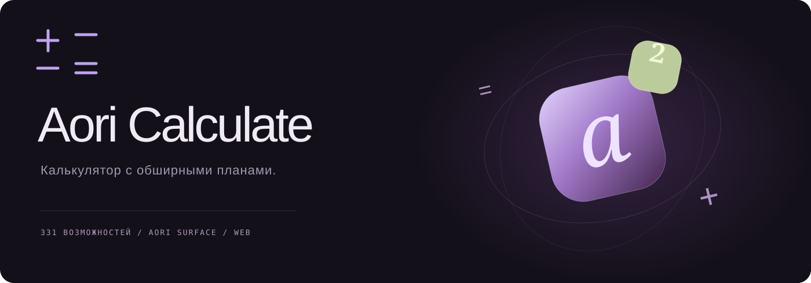
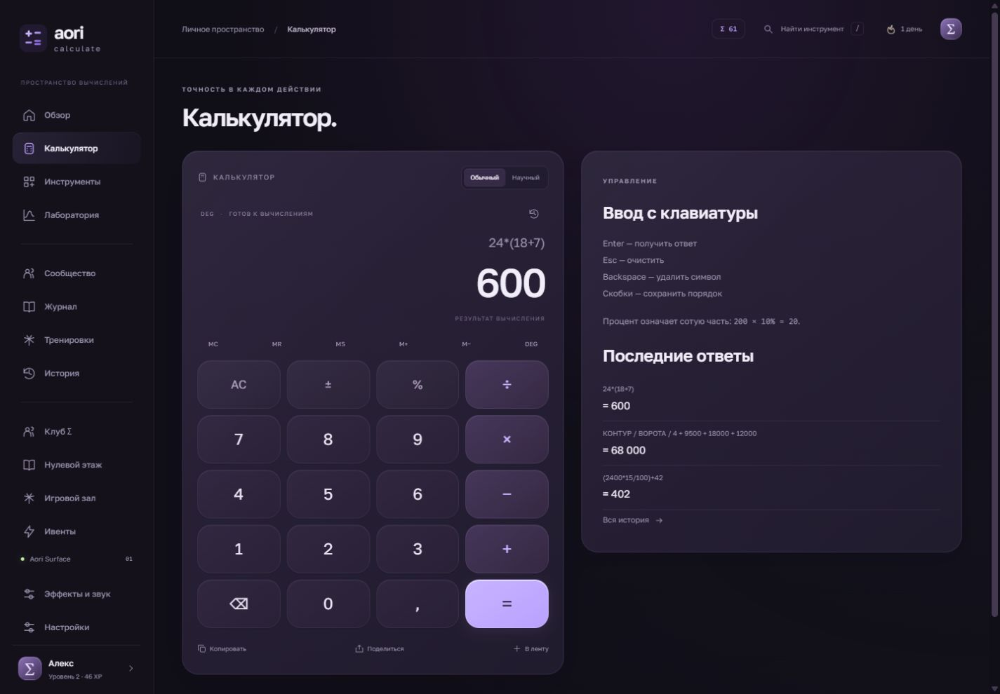
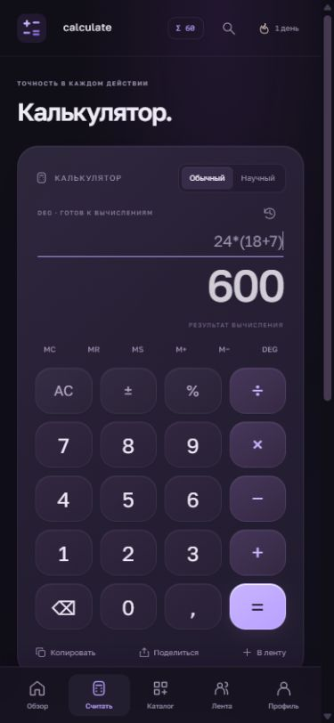
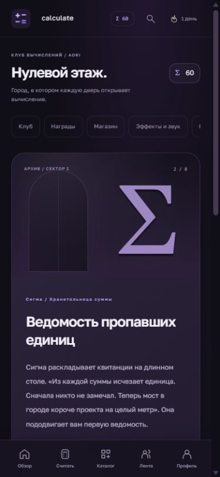
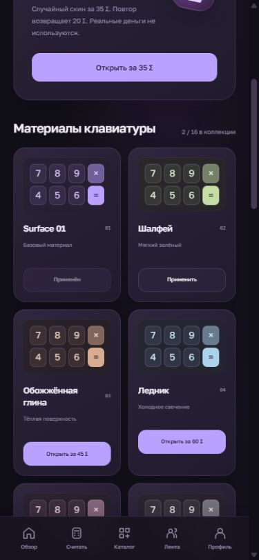
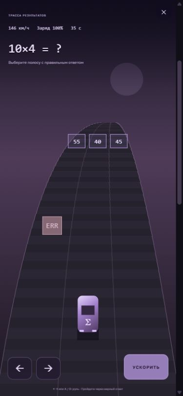
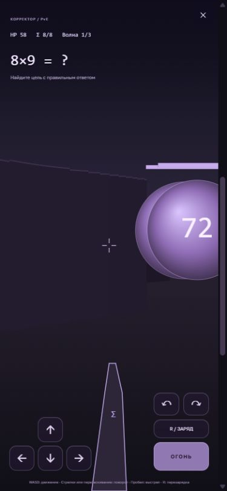
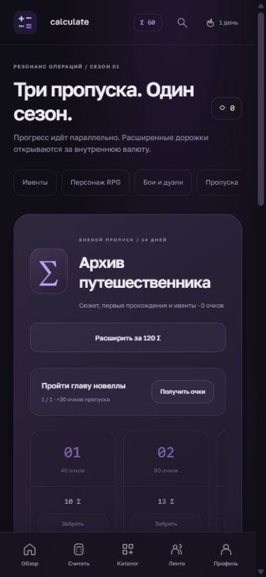

<p align="center"></p>

<p align="center"><a href="https://noriteam.github.io/ailolkek/">Открыть приложение</a> · <a href="docs/FEATURES.md">Каталог возможностей</a> · <a href="docs/ARCHITECTURE.md">Устройство проекта</a></p>

# Aori Calculate

Калькулятор, который слишком серьёзно отнёсся к развитию продукта.

Сначала у него появились проценты и память. Потом — профиль, истории, подписки, собственная валюта, магазин скинов и восьмиглавная новелла. При этом у каждой надстройки осталась связь с вычислениями: в истории публикуется формула, в игре нужно найти ответ, рекламная карточка открывает смету, а дверь в новелле не откроется без решения задачи.

Шуточный проект для портфолио о том, как далеко может зайти обычное приложение, если вовремя не остановить список требований. Сам интерфейс сохраняет серьёзную подачу.

| Расчёты                            | Пространство                               | Оформление                  |
| ---------------------------------- | ------------------------------------------ | --------------------------- |
| 101 специализированный калькулятор | Истории формул и локальная лента           | Материалы Aori Surface      |
| 34 преобразования единиц           | Четыре персонажа и новелла                 | 16 открываемых скинов       |
| Научный ввод и память              | Пять тренировок, десять аркадных игр и бои | Эффекты клавиш и результата |
| Графики, производная, интеграл     | Стрики, задания и сезонные награды         | Четыре музыкальные темы     |

В общем каталоге — **331 пункт**. Полный перечень генерируется из тех же реестров, которые использует интерфейс.

## Экраны



<p>  </p>

## Игровые режимы

В калькулятор встроены три ивента по три этапа, RPG-персонаж с экипировкой и улучшениями, пошаговые бои и локальные дуэли. Три боевых пропуска развиваются параллельно: «Архив путешественника», «Лига операций» и «Скорость мысли». У каждого 12 уровней и две дорожки наград. Расширенные дорожки открываются за внутренние Σ.

«Трасса результатов» — управляемый заезд на 60 секунд с препятствиями и воротами ответов. «Корректор» — арена от первого лица на Canvas с рейкастингом, движением, прицелом, ботами и перезарядкой через примеры. «Последнее равенство» добавляет 12 ботов и сужающуюся зону. Режимы рассчитаны на одного игрока; дуэль двух человек проходит по очереди на одном устройстве.

<p>  </p>

## Запуск

Нужен Node.js 22 или новее. Устанавливать зависимости не требуется.

```bash
git clone https://github.com/NoriTeam/ailolkek.git
cd ailolkek
npm start
```

Откройте [localhost:4173](http://localhost:4173). Альтернатива — любой статический HTTP-сервер. Открытие HTML через `file://` не подходит для ES-модулей и service worker.

```bash
npm test
```

Тесты проверяют парсер, приоритет операций, области определения, все стандартные расчётные примеры, обратимость конвертаций, однократное получение наград, списание валюты и проверку резервных копий. GitHub Actions запускает их при push и pull request.

## Что хранится на устройстве

История, публикации, комментарии, подписки, баланс, инвентарь, сюжет и настройки сохраняются в `localStorage`. Это локальное пространство: общего сервера, регистрации и синхронизации между посетителями нет. Передать само вычисление можно ссылкой, перенести весь профиль — экспортом и импортом JSON. История также выгружается в CSV.

Внутренняя валюта **Σ** не покупается за деньги. «Поддержка клуба», капсулы и награды работают с этим же локальным балансом. Рекламная витрина использует собственные концептуальные бренды; её кнопки открывают калькуляторы бюджета. Заявки, бронирования и платежи не принимаются.

После первого успешного открытия service worker сохраняет оболочку, код и шрифты для работы без сети. Музыка создаётся через Web Audio API, голос персонажей — через доступный в браузере синтез речи. Их нужно включить вручную.

## Расчётная часть

Выражения обрабатывает собственный рекурсивный парсер, без `eval` и `Function`. Доступны скобки, степени, проценты, факториал, тригонометрия, логарифмы, постоянные, ANS и память. Процент трактуется как сотая доля: `200 × 10% = 20`.

Числа используют JavaScript Number. Настройка точности меняет отображение, а не внутреннее значение. Производная оценивается центральной разностью, интеграл — методом Симпсона с 1 000 интервалами. Эти оценки предназначены для обычных гладких функций и не доказывают сходимость несобственных интегралов.

## Стек

HTML, CSS и нативные JavaScript-модули. Сборщика и зависимостей времени исполнения нет. Статическая публикация через GitHub Pages. Шрифт Golos Text хранится локально; его лицензия находится в [fonts/OFL.txt](fonts/OFL.txt).

Код проекта опубликован под [MIT](LICENSE).
